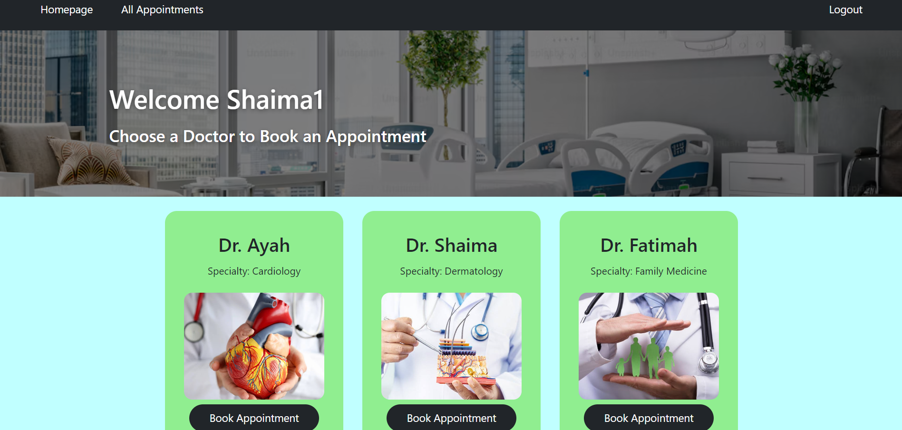
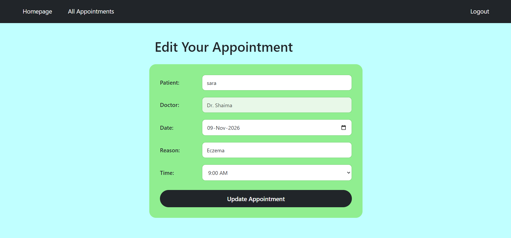

# Project Name
Medical Appointment Manager


## Overview
Medical Appointment Manager is a full-stack web application that lets patients browse doctors by specialty and book, view, edit and cancel their own appointments online. Users create an account, choose a doctor, pick an available time slot, and manage their bookings from one place. Once a time slot is booked it is no longer offered to other patients, which prevents double booking.


## Screenshots







## Technologies Used
| Area | Technology |
|---|---|
| Server | Node.js, Express |
| Views | EJS templates |
| Database | MongoDB with Mongoose |
| Authentication | express-session, bcrypt |
| Forms | method-override (PUT and DELETE from HTML forms) |
| Styling | Custom CSS |


## Getting Started
1. create a folder and cd into it 
2. clone the project in your folder 
3. create .env file
```javascript
MONGODB_URI=your-mongo-db-connection-string
SESSION_SECRET=your-sectret-key
PORT=3000
```
4. run npm i 


## User Stories
1. Sign up: As a new visitor, I want to create an account with a username and a password, so that I can book appointments.
2. Secure password: As a user, I want the app to require a password longer than 6 characters, so that my account is better protected.
3. Sign in and out: As a registered user, I want to sign in and sign out, so that only I can see and manage my appointments.
4. Browse doctors: As a patient, I want to see a list of doctors with their name, specialty and picture, so that I can choose the right doctor for my needs.
5. Book an appointment: As a patient, I want to choose a date and an available time slot with a doctor and give a reason for my visit, so that I can reserve my visit.
6. View my appointments: As a patient, I want to see a list of my own appointments and open the 7. details of each one, so that I can check when and with whom my visits are.
7. Edit an appointment: As a patient, I want to change the date, time or reason of my appointment, so that I can reschedule without booking again.
8. Cancel an appointment: As a patient, I want to cancel an appointment after a confirmation pop-up, so that I don't delete one by accident and the time slot becomes available again.


## Database Design


## Routes


| Method | Route | Description |
|---------|-------|-------------|
| GET | / | Home page |
| GET | /appointments | List all appointments |
| GET | /appointments/new | New appointment |
| POST | /appointments | Create appointment |
| GET | /appointments/:id | View appointment |
| GET | /appointments/:id/edit | Edit appointment form |
| PUT | /appointments/:id | Update appointment |
| DELETE | /appointment/:id | Delete appointment |


## Features
Accounts and security
Sign up, sign in and sign out
Passwords are hashed with bcrypt and never stored as plain text
Password validation: must be more than 6 characters, and must match the confirmation
Duplicate usernames are rejected
Session-based login, with protected routes for signed-in users only
Each user can see only their own appointments
Doctors
Homepage with a card for every doctor, showing name, specialty and image
Cards are centered and responsive, and wrap onto new rows as doctors are added
Empty state message when no doctors are available
Appointments (full CRUD)
Create: book with a doctor by choosing the date, an available time slot and a reason
Read: list of my appointments, and a details page for each one
Update: edit the patient name, date, time slot and reason
Delete: remove an appointment after confirming in a pop-up
Time slots: a booked slot becomes unavailable, and is freed again when the appointment is edited to another time or deleted
Empty state message when the user has no appointments yet
Interface
Navigation bar that changes with login status (Sign up and Login for visitors, All Appointments and Logout for signed-in users)
Hero banner on the homepage with a hospital photo
Consistent green card design across all pages
Responsive layout for desktop and mobile
Clear error messages for invalid input


## Future Enhancements
1. Exporting into Excel or PDF
2. Photo Upload
3. Admin Dashboard
4. Animations


## Credits
E- mail: shaimaawadh55@gmail.com
